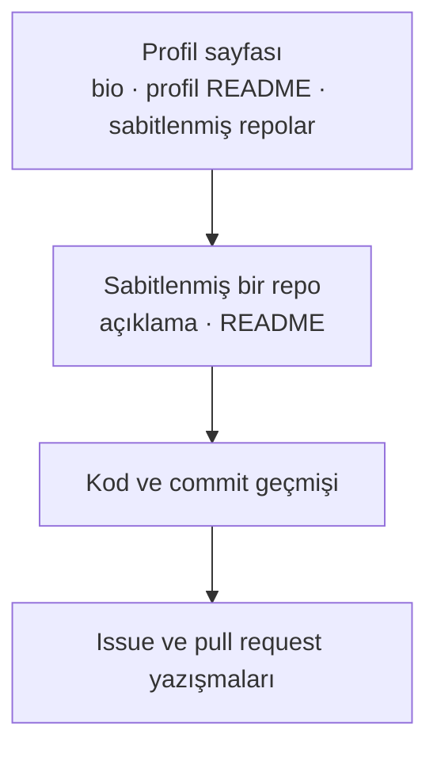

# GitHub profil checklist

CV'nize GitHub bağlantınızı eklediğinizde, onu açan kişi ilk ekranda ne görür ve bundan ne çıkarır? Bu checklist iki
kaynağa dayanıyor: profilin nasıl çalıştığını anlatan GitHub belgeleri ve işe alımda GitHub'a bakan işverenlerle
yapılmış bir araştırma. Otomatik denetlenebilen maddeleri profilinizde kontrol eden bir script de var.

| Alan | Değer |
|---|---|
| Tür | Reference |
| Alan | Kariyer · GitHub |
| Ön bilgi | Bir GitHub hesabı ve en az bir açık repo |
| Denendiği ortam | GitHub REST API · Python 3.14 (script yalnız standart kütüphaneyi kullanır) · GitHub belgeleri 2026-10-04'te okundu |
| Örnek dosyalar | [`profil-checklist/`](profil-checklist/) — `python3 profil_kontrol.py <kullanıcı-adı>` profili denetler |
| Tarih | 2026-10-04 |

> **Kısa cevap:** İlk ekranı düzenleyin: bio, profil README ve sabitlenmiş 3–5 repo. Sabitlediğiniz her repoda
> açıklama ve nasıl çalıştırılacağını anlatan bir README olsun. Yıldız ve takipçi saymayın: araştırmadaki işverenler
> popülerliği güvenilir bulmuyor; kendi başlattığınız projeyi ve başkasının projesine kabul edilmiş katkıyı buluyor.

---

## 1. Neden?

"İşe alanlar GitHub profiline bakar" cümlesi sık tekrarlanır, dayanağı nadiren gösterilir. Bu sayfanın iki dayanağı var.

**Araştırma.** Marlow ve Dabbish (2013), işe alımda GitHub kullanan yedi işveren ve profilini başvurularına ekleyen
altı iş arayanla görüştü. İşverenler profildeki izleri CV'deki beyandan daha güvenilir buldu: iş herkesin önünde
yapılıyor ve sonradan değiştirmek zor. Görüşmelerde öne çıkan beş iz:

| Profildeki iz | İşverenin çıkarımı | Güvenilir mi | Görmesi |
|---|---|---|---|
| Açık kaynağa aktif katılım | Açık kaynak değerlerini paylaşıyor | Evet | Kolay |
| Tanınmış bir projeye kabul edilmiş katkı | İşi başkalarınca onaylanmış | Evet | Zor |
| Kendi başlattığı proje | İnisiyatif, proje yönetimi | Evet | Kolay |
| Yan projeler | Kodlamaya ilgi | Evet | Zor |
| Projenin izleyici ve fork sayısı | Popülerlik | **Hayır** | Kolay |

Araştırmanın ikinci bulgusu en az tablo kadar önemli: işverenler, erişmesi ve doğrulaması az emek isteyen ipuçlarını
tercih etti. Profile bakan kişi aşağıdaki yolun başında durur ve çoğu zaman sonuna kadar gitmez.



**GitHub'ın kendi rehberi.** GitHub, profili iş aramaya hazırlamak için beş adımlık bir rehber yayınlıyor ve aynı
uyarıyı yapıyor: işe alım yöneticisi projelerinize birkaç dakikadan fazla bakmayacaktır.

İkisinin de sınırı var. Araştırma küçük ve gönüllü bir örnekleme dayanıyor, 2013 tarihli ve ABD'deki yazılım
şirketleriyle yapılmış; profil README gibi bugünkü özellikler o zaman yoktu. Rehber ise bir ölçüm değil, tavsiye.
Her işverenin GitHub'a baktığını gösteren bir veri bu sayfada yok. Checklist, bakan biri için ilk ekranı düzenler.

## 2. Checklist

| # | Madde | Dayanak |
|---|---|---|
| 1 | Bio: kim olduğunuz ve ne tür iş aradığınız, bir iki cümle | GitHub rehberi |
| 2 | Profil fotoğrafı ve website ya da portföy bağlantısı | GitHub rehberi |
| 3 | Profil README: kısa tanıtım, beceriler, en iyi projeler | GitHub rehberi |
| 4 | Sabitlenmiş 3–5 repo; kendi projeleriniz ve katkı verdikleriniz | GitHub rehberi · araştırma |
| 5 | Sabitlenen her repoda açıklama ve konu etiketleri | GitHub rehberi |
| 6 | Sabitlenen her repoda README: özellikler, kurulum ve çalıştırma, örnek, test | GitHub rehberi |
| 7 | Katkılarınız grafikte görünüyor | GitHub belgeleri |
| 8 | Değişiklik yapmadığınız fork'lar sabitli değil | Araştırma |

## 3. İlk ekran (1–4)

**Bio.** Profil fotoğrafının altındaki bir iki cümle. Rehberin önerisi: kim olduğunuzu ve ne tür bir iş aradığınızı
kısaca söyleyin.

**Profil README.** Profilin en üstünde görünen serbest metin. GitHub onu şu dört koşulun hepsi sağlanınca gösterir:

- Kullanıcı adınızla aynı adda bir repo var.
- Repo herkese açık.
- Kökünde `README.md` adlı bir dosya var.
- Dosya boş değil.

Rehberin önerdiği içerik: kısa bir tanıtım, teknik beceriler, deneyim, en iyi projeleriniz ve varsa sertifika ya da
ödüller. Sabitlenmiş kutuda projenin adı ve tek satırlık açıklaması görünür; README o projeleri neden seçtiğinizi
anlatmanın yeridir.

**Sabitlenmiş repolar.** Profilde repo ve gist toplamı en çok altı öğe sabitlenir. Rehber 3–5 proje öneriyor ve iki
türü karıştırmayı söylüyor: kendi başlattığınız projeler ve katkı verdiğiniz projeler. Bu, araştırmadaki iki güvenilir
izle örtüşüyor. Hiçbir şey sabitlemezseniz GitHub o alanda "Popular repositories" başlığıyla kendi seçtiği repoları
gösterir; sabitlerseniz ilk ekranda yalnız sizin seçtikleriniz durur.

## 4. Sabitlenen repolar (5–6)

Profilden bir repoya tıklayan kişinin gördükleri, sırayla: sağdaki "About" kutusu, sonra README.

| Yer | Ne yazılır |
|---|---|
| Açıklama | Projenin ne yaptığı, tek cümle. Sabitlenmiş kutuda da bu görünür |
| Website | Çalışan bir örnek varsa adresi |
| Konu etiketleri (topics) | Dil, framework, alan |
| README | Öne çıkan özellikler · kurulum ve çalıştırma · bir örnek ya da ekran görüntüsü · testlerin nasıl çalıştırıldığı |

Lisans rehberde geçmiyor, ama başkasının kodunuzu kullanmasını istiyorsanız gerekli: GitHub belgelerine göre lisanssız
bir repoda bütün haklar sizde kalır ve kimse kodu çoğaltamaz, dağıtamaz, türetemez.

## 5. Katkı grafiği (7)

Commit'lerinizin grafikte görünmesi için şu koşulların hepsi gerekir:

- Commit'teki e-posta adresi GitHub hesabınıza bağlı.
- Commit bir fork'ta değil, bağımsız bir repoda.
- Commit reponun varsayılan branch'inde ya da `gh-pages` branch'inde.

En sık kaçan koşul birincisidir: yeni bir bilgisayarda ya da iş makinesinde `git config user.email` başka bir adresi
gösteriyorsa commit'ler profilinize sayılmaz. Adresi hesabınıza eklediğinizde eski commit'ler de görünür.

Private repolardaki katkıları profilinizde gösterip göstermemek bir ayardır. Gösterirseniz başkaları yalnız günlük
katkı sayısını görür, ayrıntıyı görmez.

## 6. Script

[`profil_kontrol.py`](profil-checklist/profil_kontrol.py) checklist'in makineyle denetlenebilen kısmına bakar: bio,
bağlantı, profil README ve en son güncellenen altı repoda açıklama, konu etiketleri, README, lisans. Yalnız herkese
açık bilgiyi okur, token istemez, hiçbir şeyi değiştirmez. GitHub'ın örnek hesabı `octocat` üzerinde çıktısı:

```text
$ python3 profil_kontrol.py octocat
Profil: github.com/octocat

[x] Ad: The Octocat
[ ] Bio: boş
[x] Website ya da portföy bağlantısı: https://github.blog
[ ] Profil README: octocat/octocat reposunda README.md

Spoon-Knife (son push 2024-08-21)
[x]   Açıklama
[ ]   Konu etiketleri (topics)
[x]   README
[ ]   Lisans

…

git-consortium (son push 2024-07-12)
[x]   Açıklama
[ ]   Konu etiketleri (topics)
[x]   README
[x]   Lisans: MIT

…

Özet: 11 / 28 madde tamam
Açık repolar: 8 (fork: 2, arşivli: 0)

Elle bakılacaklar:
- Sabitlenen repolar: 3-5 tane, en iyi işleriniz (profil sayfasında 'Customize your pins')
- Katkı grafiği: commit'lerdeki e-posta hesabınıza bağlı mı (git config user.email)
- Sabitlenen repoların README'si: ne yapar, nasıl çalıştırılır, örnek ya da ekran görüntüsü
```

Script'in göremediği üç şey sonda listelenir. Sabitlenen repolar token'sız okunamadığı için script onların yerine en
son güncellenen altı repoya bakar; README'nin var olduğunu görür, iyi olup olmadığını göremez.

## 7. Karşı örnekler

### Yıldız ve takipçi sayısı

Araştırmadaki işverenler izleyici ve fork sayısını güvenilmez buldu: sayı, kodun kalitesinden çok sahibinin
projeyi ne kadar tanıttığını gösteriyordu. Bir işverenin sözüyle: "the popularity doesn't necessarily indicate
quality". Sayılara bakmak yerine adayın en çok commit attığı projeyi açıp kodu okuduklarını anlattılar.

### Dokunulmamış fork'lar

Bir projeyi fork'lamak tek tıklamadır ve işverenler bunu biliyordu: içinde değişiklik olmayan fork bir şey
göstermiyor. Gösteren, o projeye yapılmış ve kabul edilmiş katkıdır. Fork'ları silmeniz gerekmez; sabitlemeyin.

### Yarım projeleri silmek

Araştırmadaki iş arayanlar bu konuda ikiye ayrıldı. Bir kısmı eski kodunun kendisini olduğundan kötü gösterdiğini
düşünüyordu; bir kısmı yarım projeleri bilerek bıraktı, çünkü bir işe nasıl yaklaştığını gösteriyordu. İşverenlerin
yarım projeyi olumsuz saydığına dair bir bulgu yok. Silmek yerine iki seçenek var: sabitlememek ya da arşivlemek.
Arşivlenen repo salt okunur olur ve artık bakım yapılmadığı görünür.

### Commit mesajları, test, CI

Anlamlı commit mesajları ve okunur kod, araştırmada iş arayanların kendilerini iyi göstereceğine inandığı şeylerdi;
işverenlerin bunlara baktığı bulgular arasında yok. Test yazmak GitHub rehberinin önerisi. İkisi de iyi mühendislik
pratiğidir; "işe alanın baktığı şey" olarak sunmak için elimizde veri yok.

## 8. Ne zaman işe yaramaz

- **İşiniz private repolarda.** Profiliniz boş görünür; bu, az çalıştığınızı göstermez. Katkı sayısını görünür yapmak
  ve bir iki küçük açık proje bunu dengeler.
- **Kod paylaşılmayan alanlar.** Gömülü sistemler, savunma, finans gibi alanlarda işin kendisi paylaşılamaz. Profil
  orada CV'nin yerini tutmaz.
- **Başka platformlar.** GitLab, Codeberg ya da kendi sunucunuz. Checklist'in mantığı aynıdır, özellik adları farklı.
- **Profil, başvurunun kendisi değildir.** Araştırmada işverenler GitHub'ı adayları ayırt etmek için kullandı, sonra
  yüz yüze görüştü.

## 9. Kontrol listesi

- [ ] Bio bir iki cümle: kim olduğum ve ne aradığım
- [ ] Profil fotoğrafı ve website ya da portföy bağlantısı var
- [ ] Profil README görünüyor (repo adı kullanıcı adımla aynı, açık, kökte `README.md`)
- [ ] 3–5 repo sabitli; kendi projelerim ve katkı verdiklerim
- [ ] Sabitlenen her repoda açıklama ve konu etiketleri var
- [ ] Sabitlenen her repoda README: ne yapar, nasıl çalıştırılır, bir örnek
- [ ] `git config user.email` hesabıma bağlı bir adres
- [ ] Değişiklik yapmadığım fork'lar sabitli değil

## 10. Alıştırma

1. [`profil-checklist/`](profil-checklist/) klasöründe `python3 profil_kontrol.py <kullanıcı-adınız>` çalıştırın.
   Kaç madde eksik?
2. Eksiklerden üçünü kapatıp script'i yeniden çalıştırın. Hangisi en az zaman aldı?
3. Profilinizi bilmeyen birine bağlantıyı gönderin ve iki dakika sonra sorun: ne iş yaptığınızı ve hangi projenizin
   en iyisi olduğunu söyleyebiliyor mu?
4. Sabitlediğiniz bir repoyu temiz bir klasöre klonlayın ve yalnız README'deki talimatla çalıştırmayı deneyin.

## Kaynaklar

- Marlow, J. ve Dabbish, L. (2013). *Activity traces and signals in software developer recruitment and hiring.*
  CSCW '13, s. 145–156. [doi:10.1145/2441776.2441794](https://doi.org/10.1145/2441776.2441794).
- GitHub Docs — [Using your GitHub profile to enhance your resume](https://docs.github.com/en/account-and-profile/tutorials/using-your-github-profile-to-enhance-your-resume).
- GitHub Docs — [Managing your profile README](https://docs.github.com/en/account-and-profile/how-tos/profile-customization/managing-your-profile-readme) ·
  [Pinning items to your profile](https://docs.github.com/en/account-and-profile/how-tos/profile-customization/pinning-items-to-your-profile).
- GitHub Docs — [Profile contributions reference](https://docs.github.com/en/account-and-profile/reference/profile-contributions-reference) ·
  [Troubleshooting missing contributions](https://docs.github.com/en/account-and-profile/how-tos/contribution-settings/troubleshooting-missing-contributions) ·
  [Private contributions](https://docs.github.com/en/account-and-profile/how-tos/contribution-settings/manage-visibility-settings-for-private-contributions-and-achievements).
- GitHub Docs — [Licensing a repository](https://docs.github.com/en/repositories/managing-your-repositorys-settings-and-features/customizing-your-repository/licensing-a-repository) ·
  [Archiving repositories](https://docs.github.com/en/repositories/archiving-a-github-repository/archiving-repositories).
- Örnek çıktı: [`profil-checklist/profil_kontrol.py`](profil-checklist/profil_kontrol.py), 2026-10-04.
