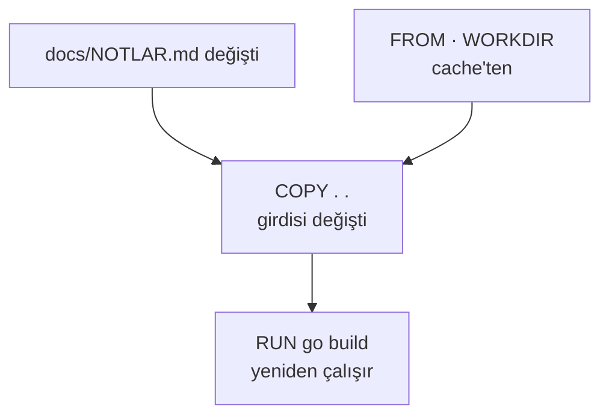

# Docker build cache: .dockerignore ve cache mount

Bir not dosyasını değiştirdik, Docker servisi baştan derledi: 4,4 saniye. `.dockerignore` ekleyince aynı build 0,14
saniyeye, cache mount ile kod değişikliğinden sonraki build 4,4 saniyeden 0,6 saniyeye indi. Bu not, build cache'in
neye göre geçersiz kaldığını üç Dockerfile düzenini beş farklı değişiklikle ölçerek anlatıyor.

| Alan | Değer |
|---|---|
| Tür | Engineering Note |
| Alan | Cloud ve DevOps · Docker |
| Ön bilgi | Dockerfile yazmış ve `docker build` çalıştırmış olmak |
| Denendiği ortam | Docker Engine 29.8.1 (BuildKit) · Docker Desktop, macOS · `linux/arm64` · Go 1.26.8 (`golang:1.26-alpine`) |
| Örnek dosyalar | [`build-cache/`](build-cache/) — `./measure.sh` bu nottaki ölçüm tablosunu yeniden üretir |
| Tarih | 2026-10-04 |

> **Kısa cevap:** Docker bir adımı, o adımın girdisi değişmediyse cache'ten alır; değiştiyse o adımı ve sonraki
> bütün adımları yeniden çalıştırır. `COPY . .` adımının girdisi klasördeki her dosyadır. Girdiyi `.dockerignore` ve
> seçici `COPY` ile daraltın; yeniden çalışması kaçınılmaz olan derlemeyi cache mount ile kısaltın.

---

## 1. Neden?

Ölçtüğümüz servis tek dosyalık bir Go programı. Yanındaki `docs/NOTLAR.md` dosyasına bir satır ekleyip yeniden build
ettik. Not dosyası derlemeye girmiyor, ama Docker derlemeyi baştan çalıştırdı: 4,43 saniye. Hiçbir şey
değiştirmeden yapılan build ise 0,14 saniye sürüyor.



Bu servis küçük olduğu için kayıp dört saniye. Kural, derlemesi dakikalar süren projede de aynıdır; orada her
README düzeltmesi, her yorum satırı aynı dakikaları yeniden harcatır. İkinci bir maliyet daha var: `COPY . .`
klasördeki her şeyi imaja koyar. Ölçümde derlemeyle ilgisi olmayan 52,4 MB'lık veri dosyası imajın içindeydi.

## 2. Ne?

Docker her Dockerfile satırını bir adım olarak çalıştırır ve sonucunu saklar. Sonraki build'de adımı yeniden
çalıştırmak yerine saklanan sonucu kullanması için iki şey aynı kalmalıdır: satırın kendisi ve girdisi.

| Satır | Girdisi |
|---|---|
| `FROM` | Base imaj |
| `COPY` · `ADD` | Kopyalanan dosyaların içeriği |
| `RUN` | Komutun metni ve kendisinden önceki adımların sonucu |

Kural tek yönlüdür: **bir adım cache'ten gelmezse ondan sonraki hiçbir adım da gelmez.** Bu yüzden Dockerfile'da sıra
önemlidir; sık değişen girdi ne kadar aşağıdaysa, cache'ten o kadar çok adım gelir.

"İçerik" derken gerçekten içerik: `touch main.go` ile dosyanın yalnız değiştirilme zamanını güncelledik, build
cache'ten geldi ([§ 4](#4-ölçüm), `mtime` satırı).

## 3. Nasıl?

### Önce: `naive`

```dockerfile
FROM golang:1.26-alpine
WORKDIR /src
COPY . .
RUN CGO_ENABLED=0 go build -o /out/app .
```

### Birinci adım: `.dockerignore`

Dockerfile aynı kalır; yanına bir `.dockerignore` gelir. Buradaki dosyalar build'e hiç gönderilmez, `COPY . .`
onları görmez:

```text
.git
docs
veri
*.md
Dockerfile*
.dockerignore
```

### İkinci adım: seçici `COPY` ve cache mount

```dockerfile
FROM golang:1.26-alpine
WORKDIR /src
COPY go.mod ./
COPY *.go ./
RUN --mount=type=cache,target=/root/.cache/go-build CGO_ENABLED=0 go build -o /out/app .
```

| Satır | Neden |
|---|---|
| `COPY go.mod ./` · `COPY *.go ./` | Girdi, adı yazılan dosyalardan ibarettir. Klasöre sonradan eklenen bir dosya derlemeyi tetiklemez |
| `--mount=type=cache,target=…` | Bu klasör build'ler arasında saklanır ve imaja girmez. Go derleme cache'ini burada tutar; adım yeniden çalışınca yalnız değişen paketi derler |
| `target=/root/.cache/go-build` | Go'nun derleme cache'inin varsayılan yeri (`go env GOCACHE`). Her araç için farklıdır |

## 4. Ölçüm

Üç düzen, beş değişiklik; her hücre üç build'in ortancası. Süre `docker build` komutunun toplam süresi;
"derledi" `RUN go build` adımının yeniden çalıştığını, "cache" saklanan sonucun kullanıldığını gösterir.

| Değişen | `naive` | `ignore` | `mount` |
|---|---|---|---|
| Hiçbir şey | 0,14 s · cache | 0,14 s · cache | 0,15 s · cache |
| `main.go`'nun yalnız zamanı (`touch`) | 0,14 s · cache | 0,14 s · cache | 0,14 s · cache |
| `docs/NOTLAR.md` | **4,43 s · derledi** | 0,14 s · cache | 0,14 s · cache |
| Klasöre yeni bir dosya | **4,54 s · derledi** | **4,65 s · derledi** | 0,14 s · cache |
| `main.go` | **4,52 s · derledi** | **4,44 s · derledi** | 0,60 s · derledi |

| | `naive` | `ignore` | `mount` |
|---|---|---|---|
| İlk build'de gönderilen context | 52,44 MB | 457 B | 457 B |
| `COPY` katmanı | 52,4 MB | 536 B | 473 B |
| `RUN go build` katmanı | 92,4 MB | 92,4 MB | 7,85 MB |
| İmaj | 381,7 MB | 329,3 MB | 244,7 MB |

Tablolardan dört sonuç çıkıyor:

1. **`.dockerignore` not dosyasını çözdü, yeni dosyayı çözmedi.** Listeye yazılmamış her dosya hâlâ `COPY . .`'nın
   girdisidir. Editörün bıraktığı geçici dosya, yeni bir çıktı klasörü ya da indirilen bir arşiv derlemeyi tetikler.
2. **Seçici `COPY` tersinden çalışır.** Neyin girmeyeceğini değil, neyin gireceğini yazarsınız; listede olmayan
   dosya build'e gönderilmez bile (context 54 B).
3. **Cache mount adımı atlatmaz, kısaltır.** `main.go` değişince derleme üç düzende de yeniden çalıştı. Mount'ta
   0,60 saniye sürdü, çünkü standart kütüphanenin derlenmiş hali saklıydı.
4. **İmaj da küçüldü.** `ignore` 52,4 MB'lık veri dosyasını imajdan çıkardı. `mount`'ta derleme cache'i imaja değil
   mount'a yazıldığı için `RUN` katmanı 92,4 MB'tan 7,85 MB'a indi.

Script'i altı kez çalıştırdık: derleme gereken build'ler 3,6–4,7 s, cache'ten gelenler 0,13–0,25 s, mount ile kod
değişikliği 0,44–0,86 s aralığında kaldı. Süreler makineye göre değişir; hangi hücrenin "derledi" olduğu değişmez.

## 5. Karşı örnekler

### Cache mount imajda değil, builder'da durur

Derleme cache'i kaybolmadı, yer değiştirdi:

```text
$ docker buildx du --filter type=exec.cachemount
ID                           RECLAIMABLE   SIZE      LAST ACCESSED
nbfjhrqohtikblwm69s0mfbx2*   true          84.78MB   9 seconds ago
```

Bu cache o builder'a aittir. İmajla birlikte registry'ye gitmez, başka bir makineye taşınmaz. Her işi temiz bir
builder'la başlatan bir CI'da mount boş başlar ve derleme ilk seferki kadar sürer; cache'in işler arasında nasıl
saklanacağı CI'ın konusudur. Bu notta ölçmedik.

### Cache yer kaplar

Cache'ten gelmeyen her adım yeni bir katman bırakır; eskisi silinmez. `naive` düzeninde her yeniden derleme 144,8 MB
(52,4 + 92,4), `ignore` düzeninde 92,4 MB ekler. Katman boyutlarından hesapla `measure.sh`'ın tek çalıştırması
builder'da yaklaşık 2 GB bırakıyor. Bu notu yazarken script'i art arda çalıştırdık ve yedinci çalıştırmada ölçüm
makinesinin diski doldu. Temizlikte 106 etiketsiz imaj çıktı ve `docker builder prune` 12,56 GB geri verdi.
`docker system df` build cache'in ne kadar yer tuttuğunu gösterir, `docker builder prune` kullanılmayanı siler.

### Context her build'de gönderilmez, ilk build'de gönderilir

`naive` düzeninde ilk build 52,44 MB gönderdi, sonraki build'ler yalnız değişeni: 236–773 B. BuildKit önceki
context'i hatırlıyor. Yeni bir klasörde ya da temiz bir builder'da hatırlayacağı bir şey yoktur ve bütün klasör
yeniden gönderilir. `.dockerignore`'un context üzerindeki kazancı bu yüzden en çok orada görünür.

### `.dockerignore` unutulan dosyayı korumaz

`COPY . .` klasördeki her şeyi imaja koyar. Ölçümde bu zararsız bir veri dosyasıydı; gerçek projede `.git` geçmişi,
`.env` dosyası ya da yerel anahtarlar olabilir. İmaja giren dosya, sonraki bir adımda silinse de alttaki katmanda
durur ([multi-stage build](multi-stage-build.md), § 5). Gizli dosyaları `.dockerignore`'a yazın; mümkünse seçici
`COPY` kullanın.

## 6. Hangisini seçmek

| | `.dockerignore` | Seçici `COPY` | Cache mount |
|---|---|---|---|
| Neyi çözer | İlgisiz dosyanın derlemeyi tetiklemesi · context boyutu · imaja sızan dosya | Listede olmayan her dosya | Kaçınılmaz derlemenin süresi · imajdaki derleme cache'i |
| Bedeli | Liste elle güncel tutulur | Yeni kaynak klasörü eklenince Dockerfile da değişir | Araca özgü yol; builder'a bağlı |
| Ne zaman | Her projede | Girdi az sayıda dosya ya da klasörse | Derleme adımı sık çalışıyor ve aracın cache klasörü varsa |

Üçü birbirinin yerine geçmez. Sıralama: önce `.dockerignore`, sonra seçici `COPY`, derleme hâlâ yavaşsa cache mount.

## 7. Ne zaman kullanılmaz

- **Bağımlılık indiren projeler.** Bu servis yalnız standart kütüphaneyi kullanıyor. Bağımlılığı olan projede asıl
  kazanç, bağımlılık dosyalarını kaynak koddan önce kopyalayıp indirme adımını ayrı tutmaktır
  ([multi-stage build](multi-stage-build.md), § 3). Bu notta ölçmedik.
- **Girdisi Dockerfile'da görünmeyen `RUN`.** `RUN apt-get update` ya da `RUN curl …` satırının metni değişmediği
  sürece adım cache'ten gelir; uzaktaki paket ya da dosya güncellense de. Bilerek yenilemek için
  `docker build --no-cache` kullanılır.
- **Eski builder.** Cache mount BuildKit ister; Docker 23'ten beri varsayılan builder odur.
- **Cache'e güvenmediğiniz build.** Yayın build'ini temiz almak istiyorsanız `--no-cache` her adımı yeniden
  çalıştırır.

## 8. Kontrol listesi

- [ ] `.dockerignore` var: `.git`, dokümanlar, veri ve çıktı klasörleri, gizli dosyalar listede
- [ ] Sık değişen dosyalar Dockerfile'da mümkün olduğunca aşağıda
- [ ] `COPY . .` yerine, mümkünse yalnız gereken dosya ve klasörler kopyalanıyor
- [ ] Derleme adımı aracın cache klasörünü mount ediyor
- [ ] İlgisiz bir dosyayı değiştirip build'in cache'ten geldiği denendi
- [ ] İmajda beklenmeyen dosya yok (`docker history` ile katman boyutlarına bakıldı)

## 9. Alıştırma

1. [`build-cache/`](build-cache/) klasöründe `./measure.sh` çalıştırın ve tabloyu kendi makinenizde üretin.
2. `dockerignore.example` dosyasından `docs` satırını silip yeniden ölçün. Beklenen: `ignore` düzeninde `not`
   satırı da "yeniden" olur.
3. `Dockerfile.mount`'taki iki `COPY` satırının yerini değiştirin. Ölçüm değişiyor mu? Neden değişmiyor?
4. Kendi projenizde ilgisiz bir dosyayı (README, bir not) değiştirip `docker build --progress=plain` çalıştırın.
   Hangi adımdan itibaren `CACHED` yazmıyor?

## Kaynaklar

- Docker Docs — [Build cache](https://docs.docker.com/build/cache/) ·
  [Build cache invalidation](https://docs.docker.com/build/cache/invalidation/) ·
  [Optimize cache usage](https://docs.docker.com/build/cache/optimize/).
- Docker Docs — [.dockerignore files](https://docs.docker.com/build/concepts/context/#dockerignore-files) ·
  [`RUN --mount=type=cache`](https://docs.docker.com/reference/dockerfile/#run---mounttypecache).
- Go — [`go env GOCACHE`](https://pkg.go.dev/cmd/go#hdr-Build_and_test_caching): derleme cache'i.
- Ölçümler: [`build-cache/measure.sh`](build-cache/measure.sh), 2026-10-04.
