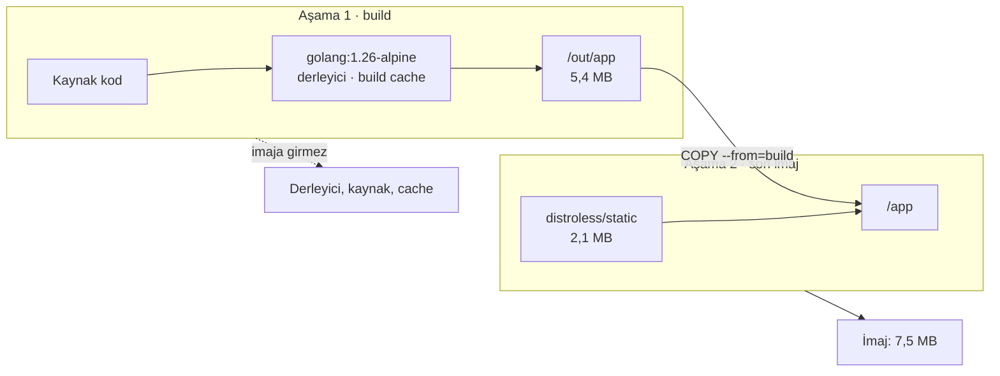

# Docker imajını küçültmek: multi-stage build

Aynı Go servisini tek aşamalı ve çok aşamalı Dockerfile ile build edip yedi varyantı ölçtük: imaj 330,1 MB'tan
7,5 MB'a indi. Bu not farkın nereden geldiğini, son aşamanın nasıl seçileceğini ve küçük imajın gizli
maliyetlerini anlatıyor.

| Alan | Değer |
|---|---|
| Tür | Engineering Note |
| Alan | Cloud ve DevOps · Docker |
| Ön bilgi | `docker build` ile imaj oluşturmuş olmak |
| Denendiği ortam | Docker Engine 29.8.1 · `linux/arm64` · Go 1.26.7 · Alpine 3.24.1 · `distroless/static-debian12` |
| Örnek dosyalar | [`multi-stage-build/`](multi-stage-build/) — `./measure.sh` bu nottaki ölçüm tablosunu yeniden üretir |
| Tarih | 2026-09-30 |

> **Kısa cevap:** Derleme için gereken her şey (derleyici, kaynak kod, build cache) çalışma zamanında gerekmez.
> Multi-stage build derlemeyi bir aşamada yapar, son imaja yalnız çıktıyı kopyalar.

---

## 1. Neden?

Tek aşamalı Dockerfile'da derleme ve çalıştırma aynı imajda olur. Ölçtüğümüz servisin binary'si 7,8 MB, imajı
330,1 MB. `docker history` farkın nereden geldiğini gösteriyor:

| Katman | Boyut |
|---|---|
| `golang:1.26-alpine` — Alpine + Go toolchain | 236,8 MB |
| `go build` — binary ve Go build cache'i (`/root/.cache/go-build`) | 93,3 MB |
| Kaynak kod | 1,2 kB |

Servisin çalışmak için ihtiyaç duyduğu tek dosya binary'nin kendisi. Geri kalanın üç maliyeti var:

- **Transfer.** Registry'ye sıkıştırılarak gönderilen boyut, `docker save | gzip` ile ölçtüğümüzde tek aşamada
  91,7 MB, çok aşamada 2,9 MB. Her deploy, her CI job'ı ve her yeni sunucu bu farkı yeniden indirir.
- **Saldırı yüzeyi.** Production container'ında derleyici, shell ve paket yöneticisi durur; servis hiçbirini
  kullanmaz, ama container'a erişen biri kullanabilir.
- **Tarama gürültüsü.** İmaj tarayıcıları imajdaki her paketi tarar; servisin hiç kullanmadığı paketlerin bulguları
  da raporda yer alır ve güncellenmesi gerekir.

## 2. Ne?

Multi-stage build, bir Dockerfile'da birden fazla `FROM` kullanmaktır. Her `FROM` yeni bir aşama başlatır;
`COPY --from=<aşama>` önceki bir aşamadan dosya alır. İmaja **yalnız son aşama** — ya da `--target` ile seçilen
aşama — dönüşür; önceki aşamaların katmanları imaja girmez.



BuildKit (Docker 23'ten beri varsayılan builder) yalnız hedef aşamanın bağlı olduğu aşamaları build eder. Bu yüzden
aynı Dockerfile'da birden fazla son aşama tutup `--target` ile seçebilirsiniz; [örnek dosyalar](multi-stage-build/)
dört farklı son aşamayı bu şekilde tek Dockerfile'da taşıyor.

## 3. Nasıl?

### Önce: tek aşama

```dockerfile
FROM golang:1.26-alpine
WORKDIR /src
COPY go.mod main.go ./
RUN go build -o /app .
EXPOSE 8080
CMD ["/app"]
```

### Sonra: iki aşama

```dockerfile
FROM golang:1.26-alpine AS build
WORKDIR /src
COPY go.mod ./
RUN go mod download
COPY main.go ./
RUN CGO_ENABLED=0 go build -trimpath -ldflags="-s -w" -o /out/app .

FROM gcr.io/distroless/static-debian12:nonroot
COPY --from=build /out/app /app
EXPOSE 8080
ENTRYPOINT ["/app"]
```

```bash
docker build -t servis .
docker run --rm -p 8080:8080 servis
```

| Satır | Neden |
|---|---|
| `AS build` | Aşamaya isim verir. `COPY --from=build`, Dockerfile'daki sıra değişse de doğru aşamayı bulur |
| `COPY go.mod` → `go mod download` → `COPY main.go` | Bağımlılık katmanı cache'te kalır; yalnız kod değiştiğinde modüller yeniden indirilmez |
| `CGO_ENABLED=0` | C kütüphanesine bağlanmayan statik binary üretir; libc içermeyen son imajda çalışmasının şartı ([§ 7](#7-ne-zaman-kullanılmaz)) |
| `-ldflags="-s -w"` | Sembol ve debug tablolarını atar: binary 7,8 MB'tan 5,4 MB'a iner |
| `-trimpath` | Build makinesinin dosya yollarını binary'ye gömmez |
| `:nonroot` | Container root yerine 65532 numaralı kullanıcıyla çalışır |

## 4. Ölçüm

Yedi varyant, aynı [`main.go`](multi-stage-build/main.go). Boyut `docker image inspect --format '{{.Size}}'` ile
ölçülen, diskteki açılmış boyuttur. `-check` bayrağı binary'nin saat dilimi veritabanını ve CA sertifika paketini
bulup bulamadığını denetler.

| Varyant | Son aşama | Boyut | Saat dilimi | CA sertifikaları |
|---|---|---|---|---|
| `single` | `golang:1.26-alpine` | 330,1 MB | var | var |
| `single-cleanup` | aynı + ayrı `RUN rm -rf` | 330,1 MB | **eksik** | var |
| `alpine` | `alpine:3.24` | 14,0 MB | **eksik** | var |
| `distroless-unstripped` | distroless, `-s -w` olmadan | 9,9 MB | var | var |
| `distroless` | `distroless/static-debian12:nonroot` | **7,5 MB** | var | var |
| `scratch-bare` | `scratch`, yalnız binary | 5,4 MB | **eksik** | **eksik** |
| `scratch` | `scratch` + elle eklenen dosyalar | 6,0 MB | var | var |

Tablodan üç sonuç çıkıyor:

1. **Kazancın çoğu ikinci aşamadan geliyor.** Binary'yi küçültmeden bile 330,1 MB → 9,9 MB.
2. **Binary'yi küçültmek ikinci sırada.** `-s -w` ile 9,9 MB → 7,5 MB.
3. **Son aşamayı boyut değil içerik belirler.** Seçenekler arasındaki fark birkaç MB; asıl fark içlerinde ne
   olduğunda ([§ 6](#6-son-aşamayı-seçmek)).

Ölçümü `linux/arm64`'te yaptık; `linux/amd64`'te sayılar biraz farklı çıkar. Kendi makinenizde
`./measure.sh` ile tabloyu yeniden üretebilirsiniz.

## 5. Karşı örnekler

### Silmek küçültmez

`single-cleanup` varyantı, derlemeden sonra Go toolchain'ini ve build cache'ini ayrı bir `RUN` ile siler. İmaj
330,1 MB'ta kalıyor; `docker history` silme katmanını 0 B gösteriyor:

```text
0B      RUN /bin/sh -c rm -rf /usr/local/go /root/.cache/go-build
93.3MB  RUN /bin/sh -c go build -o /app .
```

İmaj katmanlardan oluşur ve katmanlar yalnız eklenir. Bir katmanda silinen dosya alttaki katmanda durmaya devam
eder; yeni katman yalnız "silindi" işaretini taşır. Aynı `RUN` içinde silmek build cache'ini katmana hiç sokmaz,
ama derleyici base imajın kendi katmanında olduğu için onu çıkaramaz. Derleyicisiz bir imajla bitirmenin yolu,
son aşamayı derleyicisiz bir imajdan başlatmaktır.

### Sessiz kırılma: saat dilimi

`single` imajında saat dilimi çalışıyor, `single-cleanup` ve `alpine`'da çalışmıyor. Go, sistemde saat dilimi
veritabanı bulamazsa `$GOROOT/lib/time/zoneinfo.zip` dosyasına bakar (`go doc time.LoadLocation`). Tek aşamalı
imajda Go toolchain durduğu için bu dosya vardır; toolchain imajdan çıkınca özellik de sessizce gider. Alpine base
imajı da saat dilimi paketi (`tzdata`) taşımaz.

Hata build sırasında değil, kod `time.LoadLocation` çağırdığı anda çıkar:

```text
unknown time zone Europe/Istanbul
```

Tek aşamadan çok aşamaya geçerken, eski imajda çalışan davranışları yeni imajda da test edin. Örnekteki `-check`
bayrağı bunun en küçük hali.

### Boş imaj gerçekten boştur

`scratch-bare` en küçük varyant (5,4 MB), ama ne sertifika ne saat dilimi var. HTTPS isteği yapan bir servis
burada sertifika doğrulayamaz. Eksikler elle eklenebilir:

```dockerfile
FROM scratch
COPY --from=build /etc/ssl/certs/ca-certificates.crt /etc/ssl/certs/
COPY --from=build /usr/local/go/lib/time/zoneinfo.zip /zoneinfo.zip
ENV ZONEINFO=/zoneinfo.zip
COPY --from=build /out/app /app
USER 65534:65534
ENTRYPOINT ["/app"]
```

Bu hali 6,0 MB ve iki kontrolden de geçiyor. Distroless'ın 7,5 MB'ı ile arasındaki 1,5 MB, bu dosyaları sizin
yerinize yöneten bir imajın farkı.

## 6. Son aşamayı seçmek

| | `scratch` | `distroless/static` | `alpine` |
|---|---|---|---|
| Servisle birlikte boyut | 5,4 MB · eksikler eklenince 6,0 MB | 7,5 MB | 14,0 MB |
| CA sertifikaları | yok — elle kopyalanır | var | var |
| Saat dilimi | yok — elle eklenir | var | yok |
| Shell | yok | yok (`:debug` etiketinde busybox) | var |
| Paket yöneticisi | yok | yok | `apk` |
| Root olmayan kullanıcı | `USER` ile elle | `:nonroot` etiketi | `USER` ile elle |
| Uygun olduğu yer | İmaja giren her dosyayı kendiniz seçmek istediğinizde | Statik binary için varsayılan | Container içinde shell ve paket gerektiğinde |

Statik bir Go binary'si için tercihimiz `distroless/static:nonroot`: scratch'ten 1,5 MB büyük, ama sertifika,
saat dilimi ve kullanıcı sorununu hazır çözüyor. Distroless'ın bu imajın içeriği olarak listelediği dosyalar:
CA sertifikaları, `/etc/passwd`, `/tmp` ve tzdata.

## 7. Ne zaman kullanılmaz

- **cgo kullanan binary.** C kütüphanesine bağlanan bir binary, libc içermeyen `scratch` ve `distroless/static`
  imajında çalışmaz. Go, C derleyicisi bulabildiği yerde cgo'yu varsayılan olarak açar (`go doc cmd/cgo`);
  `golang:1.26-alpine`'da C derleyicisi olmadığı için bizim ölçümümüzde kapalıydı. Derleme imajını değiştirince
  sonuç değişmesin diye `CGO_ENABLED=0`'ı açıkça yazıyoruz. cgo gerçekten gerekiyorsa son aşama glibc içeren
  `distroless/base` olmalı.
- **Yorumlanan diller.** Python ve Node.js'te interpreter son imajda kalmak zorunda. Kazanç, derleme araçlarını
  (C eklentileri için gcc, TypeScript derleyicisi, `devDependencies`) dışarıda bırakmaktan gelir. Bu notta
  ölçmedik; Go'daki 44 katlık farkı beklemeyin.
- **Container içinde debug.** Distroless ve scratch'te shell yok:

  ```text
  $ docker run --rm --entrypoint sh servis
  docker: Error response from daemon: … exec: "sh": executable file not found in $PATH
  ```

  Production'da shell gerekiyorsa distroless'ın `:debug` etiketi busybox shell ekler. Geliştirmede
  `docker build --target build` ile derleme aşamasının kendisini çalıştırabilirsiniz.
- **Tek seferlik, yerel işler.** İmaj bir registry'ye gitmiyor ve tekrar tekrar çekilmiyorsa ikinci aşamanın
  getirdiği karmaşıklık kazancından büyük olabilir.

## 8. Kontrol listesi

- [ ] Derleme ve çalıştırma ayrı aşamalarda (`FROM ... AS build`)
- [ ] `COPY --from=` aşama numarası değil aşama adı kullanıyor
- [ ] Bağımlılık dosyaları kaynak koddan önce kopyalanıyor
- [ ] Go: `CGO_ENABLED=0` açıkça yazılı; `-trimpath -ldflags="-s -w"` kullanılıyor
- [ ] Son aşama bilinçli seçildi; CA sertifikaları ve saat dilimi son imajda test edildi
- [ ] Container root olmadan çalışıyor (`USER` ya da `:nonroot`)
- [ ] Base imajlar sürümle sabitlenmiş (`alpine:3.24`, `latest` değil)
- [ ] Geçişten önce ve sonra imaj boyutu ölçüldü

## 9. Alıştırma

1. [`multi-stage-build/`](multi-stage-build/) klasöründe `./measure.sh` çalıştırın ve tabloyu kendi makinenizde
   üretin.
2. `alpine` varyantında saat dilimi eksik. `main.go`'daki import listesine `_ "time/tzdata"` ekleyip yeniden ölçün.
   Beklenen: saat dilimi **var**, imaj yaklaşık 0,4 MB büyür — bizim ölçümümüzde 14,03 MB → 14,43 MB. Go
   dokümantasyonu bu paketin programı yaklaşık 450 KB büyüttüğünü yazıyor.
3. Kendi projenizin Dockerfile'ını iki aşamaya bölün. Önceki ve sonraki boyutu, eski imajda çalışan davranışların
   yeni imajda da çalıştığını gösteren bir testle birlikte not edin.

## Kaynaklar

- Docker Docs — [Multi-stage builds](https://docs.docker.com/build/building/multi-stage/): aşama adları,
  `--target`, BuildKit'in yalnız gereken aşamaları build etmesi.
- GoogleContainerTools — [distroless](https://github.com/GoogleContainerTools/distroless) ve
  [static / base imaj içerikleri](https://github.com/GoogleContainerTools/distroless/blob/main/base/README.md).
- Go — [`time.LoadLocation`](https://pkg.go.dev/time#LoadLocation) ·
  [`time/tzdata`](https://pkg.go.dev/time/tzdata) · [cgo](https://pkg.go.dev/cmd/cgo).
- Ölçümler: [`multi-stage-build/measure.sh`](multi-stage-build/measure.sh), 2026-09-30.
