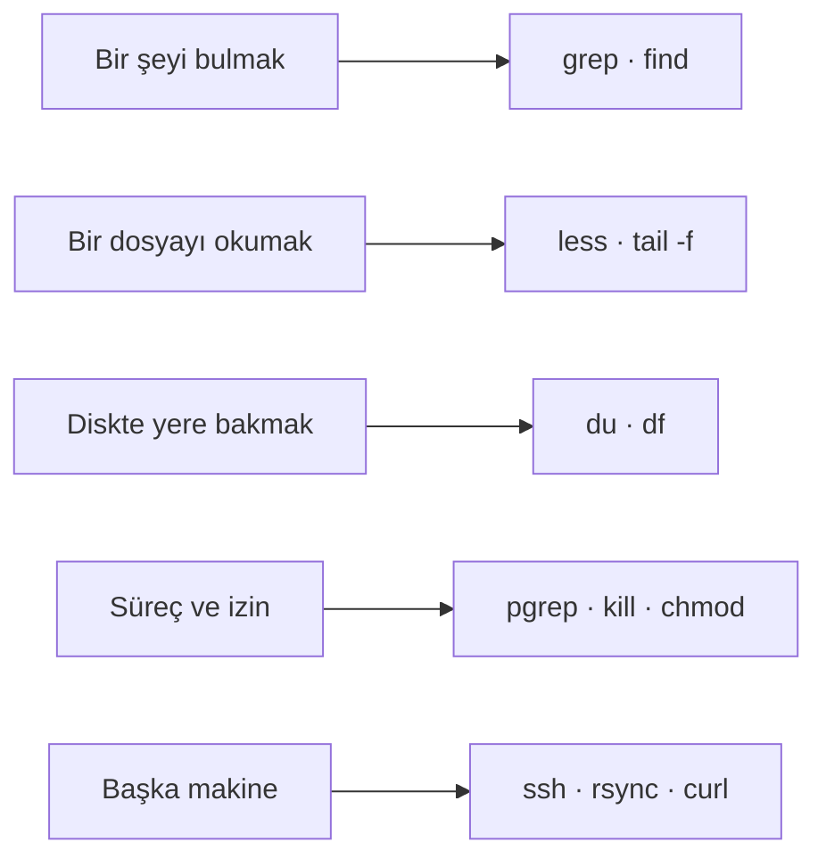

# Linux'ta her gün işe yarayan 12 komut

Log'da bir hatayı aramak, diski neyin doldurduğunu bulmak, takılan bir süreci durdurmak: sunucuda ve kendi
makinenizde her gün yapılan işlerin on iki komutu. Her komutun yanında en sık düşülen tuzak ve temiz bir Debian'da
çalıştırılmış çıktısı var.

| Alan | Değer |
|---|---|
| Tür | Reference |
| Alan | Cloud ve DevOps · Linux |
| Ön bilgi | Terminal açıp `cd` ve `ls` kullanmış olmak |
| Denendiği ortam | Debian 13.7 (`debian:13-slim`, `linux/arm64`) · bash 5.2 · GNU coreutils 9.7 · grep 3.11 · findutils 4.10 · procps-ng 4.0.4 · rsync 3.5.0 · curl 8.14.1 · OpenSSH 10.0 |
| Örnek dosyalar | [`gunluk-komutlar/`](gunluk-komutlar/) — `docker build` ve `docker run` bu sayfadaki çıktıları yeniden üretir |
| Tarih | 2026-10-04 |

> **Kısa cevap:** Bulmak için `grep` ve `find`, okumak için `less` ve `tail -f`, yer için `du` ve `df`, süreç için
> `pgrep` ve `kill`, izin için `chmod`, uzak makine için `ssh`, `rsync` ve `curl`. Tuzakların çoğu komutta değil,
> kabuğun komuta ulaşmadan önce yaptığı işte: tırnaksız `*`, gizli dosyalar, sondaki `/`.

---

## 1. Neden bu on iki?

Komut sayısı binlerle ölçülür; günlük işlerin çoğu ise beş soruya iner. Bu sayfa her soru için en çok iki ya da üç
komut verir.



Örnekler küçük bir proje klasöründe çalışıyor: iki kaynak dosyası, log'lar, bir `node_modules`, 3 MB'lık bir veri
dosyası ve 5 MB'lık gizli bir `.cache`. Klasörü [`demo.sh`](gunluk-komutlar/demo.sh) kurar.

## 2. On iki komut

| # | Komut | Ne yapar | Tuzak |
|---|---|---|---|
| 1 | `grep -rn "metin" .` | Metni alt klasörlerle birlikte arar; dosya adı ve satır numarasıyla yazar | Bağımlılık klasörlerini de tarar |
| 2 | `find . -name "*.log"` | Dosyayı adına göre bulur | Tırnaksız desen |
| 3 | `less dosya` | Büyük dosyada gezinir, arar | — |
| 4 | `tail -f app.log` | Dosyaya eklenen satırları canlı gösterir | Log dosyası yenilenince izlemeyi kaybeder |
| 5 | `du -sh *` | Her klasörün kapladığı yeri yazar | Gizli klasörleri atlar |
| 6 | `df -h` | Disklerde ne kadar yer kaldığını gösterir | — |
| 7 | `pgrep -fl ad` | Çalışan süreci adına göre bulur | Linux'ta komut satırını göstermez |
| 8 | `kill <pid>` | Sürece "kapan" sinyali yollar | `-9` temizliğe izin vermez |
| 9 | `chmod +x betik.sh` | Dosyayı çalıştırılabilir yapar | — |
| 10 | `ssh kullanici@sunucu` | Uzak makinede kabuk açar | — |
| 11 | `rsync -avz klasor/ sunucu:yol/` | Yalnız değişen dosyaları kopyalar | Sondaki `/` |
| 12 | `curl -I https://site` | Yalnız HTTP başlıklarını getirir | — |
| + | `Ctrl+R` | Daha önce yazdığınız komutu arar | — |

## 3. Bulmak (1–2)

### `grep -rn`

`-r` alt klasörlere iner, `-n` satır numarasını yazar.

```text
$ grep -rn "TODO" .
./node_modules/kutuphane/index.js:1:// TODO: eski API
./node_modules/kutuphane/index.js:2:// TODO: test
./node_modules/kutuphane/index.js:3:// TODO: belge
./src/util.py:1:# TODO: log seviyesi ayarlanabilir olsun
./src/app.py:3:# TODO: girdi doğrulaması
```

Beş sonucun üçü sizin kodunuz değil. Gerçek bir projede `node_modules` binlerce satır döndürür ve aramayı yavaşlatır:

```text
$ grep -rn --exclude-dir=node_modules "TODO" .
./src/util.py:1:# TODO: log seviyesi ayarlanabilir olsun
./src/app.py:3:# TODO: girdi doğrulaması
```

İşe yarayan iki seçenek daha: `-i` büyük küçük harf ayırmaz, `-l` satırları değil yalnız dosya adlarını yazar.

### `find . -name`

```text
$ find . -name "*.log"
./arsiv/2025/aralik.log
./arsiv/ocak.log
./logs/app.log
./logs/eski.log
```

### Karşı örnek: tırnaksız desen

Tırnak olmadan `*.log`'u `find` değil, kabuk görür ve bulunduğunuz klasördeki dosya adlarıyla değiştirir. `arsiv`
klasöründe bir log, alt klasöründe bir log daha var:

```text
$ find . -name *.log
./ocak.log
$ find . -name "*.log"
./2025/aralik.log
./ocak.log
```

Tırnaksız komut hata vermedi, yalnız eksik sonuç döndürdü: kabuk deseni `ocak.log`'a çevirdi, `find` de yalnız o adı
aradı. Klasörde iki eşleşme olunca hata görünür hale gelir:

```text
$ find . -name *.log
find: paths must precede expression: `eski.log'
find: possible unquoted pattern after predicate `-name'?
```

Bulunduğunuz klasörde hiç eşleşme yoksa kabuk desene dokunmaz ve komut doğru çalışır. Yani aynı komut üç klasörde üç
farklı davranır. Deseni her zaman tırnak içinde yazın.

## 4. Okumak (3–4)

### `less`

`cat` büyük bir dosyanın tamamını ekrana döker; `less` dosyayı açar ve içinde gezdirir. Etkileşimli olduğu için
çıktısı yok, tuşları var:

| Tuş | Ne yapar |
|---|---|
| `/metin` | İleri doğru arar |
| `n` · `N` | Sonraki · önceki eşleşme |
| `g` · `G` | Dosyanın başı · sonu |
| `F` | Sonu canlı izler, `tail -f` gibi; `Ctrl+C` ile gezinmeye döner |
| `q` | Çıkar |

### `tail -f`

```text
$ tail -n 2 logs/app.log
10:02:13 ERROR veritabanı bağlantısı koptu
10:02:14 INFO yeniden bağlanılıyor
```

`-f` komutu açık tutar; dosyaya yeni satır geldikçe yazar. Demo izleme başladıktan yarım saniye sonra dosyaya bir
satır ekliyor:

```text
$ tail -n 1 -f logs/app.log
10:02:14 INFO yeniden bağlanılıyor
10:02:15 INFO bağlantı kuruldu
```

`Ctrl+C` ile çıkılır. Log dosyaları belirli aralıklarla yeniden adlandırılıp yenisi açılıyorsa (log rotation) `-f`
eski dosyayı izlemeye devam eder; `tail -F` dosyayı adıyla izler ve yenisine geçer.

## 5. Yer (5–6)

### `du -sh *`

`-s` her öğe için tek toplam, `-h` okunur birim.

```text
$ du -sh *
16K	arsiv
4.0K	betik.sh
12K	logs
12K	node_modules
4.0K	servis.sh
12K	src
3.1M	veri
```

### Karşı örnek: en büyük klasör listede yok

Kabuk `*`'ı nokta ile başlayan adlara açmaz. Bu klasördeki en büyük öğe 5 MB'lık `.cache` ve yukarıdaki listede
görünmüyor:

```text
$ du -sh .[!.]* * | sort -h
4.0K	betik.sh
4.0K	servis.sh
12K	logs
12K	node_modules
12K	src
16K	arsiv
3.1M	veri
5.1M	.cache
```

`.[!.]*` gizli öğeleri ekler, `sort -h` birimleri anlayarak sıralar. "Disk doldu ama neyin doldurduğunu bulamıyorum"
durumunun sık görülen sebebi budur: `.cache`, `.npm`, `.git` gibi klasörler.

### `df -h`

```text
$ df -h .
Filesystem      Size  Used Avail Use% Mounted on
overlay          59G   23G   34G  41% /
```

Değerler makineye göre değişir. Sonuna yol yazınca yalnız o yolun bulunduğu disk gelir; yolsuz hali bütün diskleri
listeler. `du` klasörün ne kadar yer kapladığını, `df` diskte ne kadar yer kaldığını söyler. Disk dolu hatası alıp
`df -h`'de boş yer görüyorsanız `df -i`'ye bakın: dosya sayısı sınırı (inode) dolmuş olabilir.

## 6. Süreç ve izin (7–9)

### `pgrep`

Örnek süreç, `bash servis.sh` ile başlatılmış bir script. `-f` süreç adında değil komut satırının tamamında arar:

```text
$ pgrep -fl servis
41 bash
$ pgrep -af servis
41 bash servis.sh
```

Linux'taki `pgrep` (procps-ng) `-l` ile yalnız süreç adını yazar; komut satırının tamamı için `-a` gerekir. macOS'te
`-fl` komut satırını da gösterir. Süreç numarası (PID) her çalıştırmada farklıdır.

### `kill`

`kill` adına rağmen yalnız sinyal yollar. Sinyal belirtmezseniz `SIGTERM` gider: "işini bitir ve kapan". Örnek script
bu sinyali yakalayıp çıkmadan önce bir satır yazıyor:

```text
$ kill 41
servis: temizlik yapıldı, çıkıyorum
```

### Karşı örnek: `kill -9`

```text
$ kill -9 52
```

Çıktı yok. `SIGKILL` sürece ulaşmaz; çekirdek süreci olduğu yerde sonlandırır. Script temizlik satırını yazamadı;
gerçek bir serviste bu, yarım kalmış bir dosya yazımı, silinmemiş bir kilit dosyası ya da kapatılmamış bir bağlantı
demektir. Önce `kill`, birkaç saniye bekleyin, süreç hâlâ duruyorsa `kill -9`.

### `chmod +x`

```text
$ stat -c '%A %n' betik.sh
-rw-r--r-- betik.sh
$ ./betik.sh
bash: line 1: ./betik.sh: Permission denied
$ chmod +x betik.sh
$ stat -c '%A %n' betik.sh
-rwxr-xr-x betik.sh
$ ./betik.sh
betik çalıştı
```

`ls -l` aynı izin sütununu gösterir. `x` olmadan dosyayı `root` da çalıştıramaz; örnekler container'da `root` olarak
koşuyor ve hata yine geldi.

## 7. Uzak (10–12)

### `ssh`

```bash
ssh kullanici@sunucu
ssh kullanici@sunucu 'df -h /'
```

İlk satır uzak makinede kabuk açar, ikincisi tek bir komut çalıştırıp döner. Karşıda bir sunucu gerektiği için bu
sayfada çalıştırılmadı; demo yalnız istemcinin sürümünü yazıyor.

### `rsync -av`

`-a` izinleri, zamanları ve alt klasörleri koruyarak kopyalar, `-v` kopyalanan dosyaları yazar. İlk çalıştırma her
şeyi gönderir:

```text
$ rsync -av src/ /tmp/yedek/
sending incremental file list
./
app.py
util.py

sent 362 bytes  received 57 bytes  838.00 bytes/sec
total size is 179  speedup is 0.43
```

Hiçbir şey değişmeden ikinci çalıştırma dosya göndermez; bir dosya değişince yalnız o gider:

```text
$ rsync -av src/ /tmp/yedek/
sending incremental file list

sent 90 bytes  received 12 bytes  204.00 bytes/sec
total size is 179  speedup is 1.75
$ rsync -av src/ /tmp/yedek/
sending incremental file list
util.py

sent 243 bytes  received 35 bytes  556.00 bytes/sec
total size is 191  speedup is 0.69
```

Bayt sayıları çalıştırmadan çalıştırmaya birkaç bayt oynar. Örnek iki yerel klasör arasında; hedefi `sunucu:yol/`
yazınca aynı komut SSH üzerinden çalışır. `-z` veriyi yolda sıkıştırır: ağ üzerinden kopyalarken işe yarar, aynı
makinede yalnız işlemci harcar.

### Karşı örnek: sondaki `/`

```text
$ rsync -a src /tmp/a/
$ ls /tmp/a
src
$ rsync -a src/ /tmp/b/
$ ls /tmp/b
app.py
util.py
```

`src` klasörün kendisini, `src/` içindekileri kopyalar. Yanlış olanı seçince dosyalar bir kat içeride ya da bir kat
dışarıda kalır. Emin değilseniz `-n` ekleyin: `rsync -avn` hiçbir şey kopyalamadan ne yapacağını listeler.
`--delete` hedefte olup kaynakta olmayan dosyaları siler; yanlış `/` ile birlikte yanlış klasörü boşaltabilir, önce
mutlaka `-n` ile deneyin.

### `curl -I`

```text
$ curl -sI https://example.com | head -n 1
HTTP/2 200
```

`-I` gövdeyi indirmez, yalnız başlıkları ister; `-s` ilerleme çubuğunu gizler. Bir adresin ayakta olup olmadığını,
nereye yönlendirdiğini (`Location`) ve ne tür içerik döndüğünü (`Content-Type`) görmenin en kısa yolu. Yönlendirmeleri
izlemek için `-L` eklenir.

## 8. Bonus: `Ctrl+R`

Komut değil, kabuğun bir tuşu. Basıp komutun bir parçasını yazınca geçmişte geriye doğru arar; tekrar `Ctrl+R` bir
önceki eşleşmeye gider, `Enter` çalıştırır.

```text
$ bash -ic 'bind -q reverse-search-history' 2>/dev/null
reverse-search-history can be invoked via "\C-r".
```

## 9. Ne zaman yetmez

- **Çok büyük kod tabanında arama.** `grep -r` her dosyayı okur. `.gitignore`'u kendiliğinden dikkate alan ve
  paralel çalışan `ripgrep` (`rg`) aynı işi daha hızlı yapar; her makinede kurulu gelmez. Bu sayfada ölçmedik.
- **Servis olarak çalışan süreç.** `systemd` ya da Docker'ın yönettiği bir süreci `kill` ile durdurursanız yönetici
  onu yeniden başlatabilir. Orada `systemctl stop` ya da `docker stop` kullanılır.
- **macOS ve BSD.** Komut adları aynı, bazı seçenekler farklı: `stat -c` yoktur (`stat -f` vardır), `pgrep -a`
  komut satırını göstermez, süreç atalarını eşleşmeye katar. Bu sayfadaki çıktılar Debian'dan.
- **İnce bir container imajı.** `debian:13-slim` içinde `less`, `pgrep`, `curl`, `ssh` ve `rsync` kurulu gelmez;
  örnek [`Dockerfile`](gunluk-komutlar/Dockerfile) onları ekler.

## 10. Kontrol listesi

- [ ] `find` ve `grep` desenleri tırnak içinde
- [ ] `grep -r` bağımlılık klasörlerini dışarıda bırakıyor (`--exclude-dir`)
- [ ] Yer ararken gizli klasörlere de bakıldı (`du -sh .[!.]* *`)
- [ ] Önce `kill`, süreç kapanmazsa `kill -9`
- [ ] `rsync`'te kaynak yolunun sonundaki `/` bilinçli; `--delete`'ten önce `-n` ile denendi
- [ ] Log izlerken dosya yenileniyorsa `tail -F`

## 11. Alıştırma

1. [`gunluk-komutlar/`](gunluk-komutlar/) klasöründe `docker build -t gunluk-komutlar .` ve
   `docker run --rm gunluk-komutlar` çalıştırın. On bir kontrolün hepsi `[ok]` yazmalı.
2. `docker run --rm -it gunluk-komutlar bash` ile container'a girin, `bash /usr/local/bin/demo.sh` ile örnek projeyi
   kurun ve `cd proje` yapın. `grep -rn "ERROR" logs` ile hatayı bulun, sonra `less logs/app.log` içinde `/ERROR` ile
   aynı satıra gidin.
3. `du -sh .[!.]* * | sort -h` çıktısına bakarak klasörü 1 MB'ın altına indirmek için hangi iki öğeyi sileceğinizi
   söyleyin; silmeden önce `du` ile doğrulayın.
4. `rsync -avn --delete src/ /tmp/yedek/` çalıştırın. Çıktıda `deleting` ile başlayan bir satır var mı? `/tmp/yedek`
   içine bir dosya ekleyip tekrar deneyin.

## Kaynaklar

- GNU — [grep](https://www.gnu.org/software/grep/manual/grep.html) ·
  [findutils](https://www.gnu.org/software/findutils/manual/) ·
  [coreutils](https://www.gnu.org/software/coreutils/manual/coreutils.html): `tail`, `du`, `df`, `chmod`, `sort`.
- Bash — [Bash Reference Manual](https://www.gnu.org/software/bash/manual/bash.html): dosya adı açılımı (`*` ve
  gizli dosyalar), `kill`, geçmişte arama.
- [rsync](https://download.samba.org/pub/rsync/rsync.1) · [curl](https://curl.se/docs/manpage.html) ·
  [OpenSSH](https://www.openssh.com/manual.html) · [procps-ng](https://gitlab.com/procps-ng/procps) kılavuzları.
- Seçeneklerin açıklamaları, komutların denendiği sürümlerdeki `--help` çıktılarıyla karşılaştırıldı.
- Örnekler: [`gunluk-komutlar/demo.sh`](gunluk-komutlar/demo.sh), 2026-10-04.
