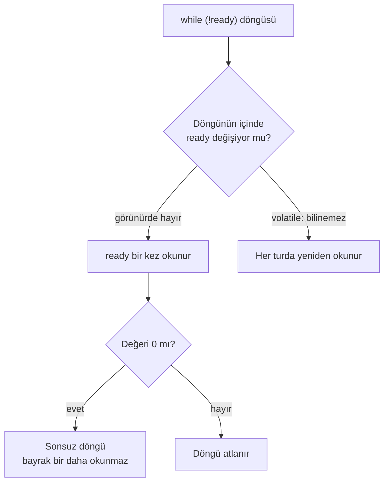

# Embedded C'de volatile: ne zaman şart, neye yetmez

Kesmenin kaldırdığı bir bayrağı bekleyen döngü `-O0` ile bir saniyede çıkıyor, `-O2` ile hiç çıkmıyor: derleyici
bayrağı döngüden önce bir kez okuyor. `volatile` bunu düzeltiyor ama paylaşılan bir sayacı korumuyor: ölçümde 541–703
sinyalin 541–634'ünde artış kayboldu. Bu not, `volatile`'ın derleyiciye ne söylediğini Cortex-M4 için üretilen
assembly ve çalıştırılmış örneklerle gösteriyor.

| Alan | Değer |
|---|---|
| Tür | Engineering Note |
| Alan | Embedded · C |
| Ön bilgi | C'de işaretçi kullanmış ve bir mikrodenetleyicide kesme (interrupt) işleyicisi görmüş olmak |
| Denendiği ortam | `arm-none-eabi-gcc` 14.2.1 (Cortex-M4, `-mthumb`) · `gcc` 14.2.0 · Debian 13.7 (`debian:13-slim`, `linux/arm64`) · Docker Engine 29.8.1 |
| Örnek dosyalar | [`volatile/`](volatile/) — `docker build -t volatile-ornek . && docker run --rm volatile-ornek` bu nottaki çıktıları yeniden üretir |
| Tarih | 2026-10-05 |

> **Kısa cevap:** `volatile` derleyiciye "bu nesne senin göremediğin bir yoldan değişebilir, her erişimi yazdığım
> gibi yap" der. Kesmeyle paylaşılan değişkende ve donanım yazmacında şarttır. Atomiklik sağlamaz: `counter++`
> `volatile` ile de üç ayrı adımdır.

---

## 1. Neden?

Embedded projelerde sık anlatılan bir hata: kod debug derlemesinde çalışır, sürüm (release) derlemesinde takılır.
En kısa hali şu döngüdür. Bayrağı kesme işleyicisi kaldırır, ana kod onu bekler:

```c
static uint8_t ready;

void EXTI0_IRQHandler(void)
{
    ready = 1;
}

int wait_for_ready(void)
{
    while (!ready) {
    }
    return 42;
}
```

Derleyici döngüye bakar: içinde `ready`'yi değiştiren bir şey yok. Kesmenin araya girebileceğini bilmez, çünkü
işleyiciyi çağıran bir kod görmez. Bu yüzden bayrağı bir kez okur ve sonucu bir daha sorgulamaz.



Aynı programı Linux'ta çalıştırdık; kesmenin yerini, bir saniye sonra gelen bir sinyal tutuyor:

| Derleme | `volatile` yok | `volatile` |
|---|---|---|
| `-O0` | 1,00 s'de çıktı | 1,00 s'de çıktı |
| `-O2` | **çıkmadı**, 3 s sonra durduruldu | 1,00 s'de çıktı |

`-O0`'daki sonuç yanıltıcıdır: kod doğru olduğu için değil, derleyici hiçbir şeyi sadeleştirmediği için çalışıyor.

## 2. Ne?

C standardı `volatile` nitelikli bir nesnenin, derleyicinin bilmediği yollarla değişebileceğini ya da başka yan
etkileri olabileceğini söyler; bu nesnelere erişim, kaynak kodda yazıldığı gibi yapılmalıdır (§ 6.7.3, § 5.1.2.3).
Pratikte derleyici üç sadeleştirmeyi yapamaz:

| Derleyici `volatile` nesnede şunu yapamaz | Sıradan nesnede yapar, çünkü |
|---|---|
| Okunan değeri saklayıp yeniden kullanmak | Arada kendisi yazmadıysa değer değişmemiştir |
| Art arda yazmaları tek yazmaya indirmek | Yalnız son yazılan değer görünür |
| Sonucu kullanılmayan okumayı silmek | Okumanın yan etkisi yoktur |

Söylemediği şeyler de önemlidir: `volatile` erişimi atomik yapmaz, kilit değildir, iki erişim arasına kimsenin
giremeyeceğini garanti etmez ([§ 5](#5-karşı-örnekler)).

## 3. Nasıl?

Üç yerde gerekir. Çıktıların hepsi `arm-none-eabi-gcc -mcpu=cortex-m4 -mthumb -O2 -ffreestanding -S` ile alındı;
yönerge ve yorum satırları atıldı.

### Kesmeyle paylaşılan değişken

[§ 1](#1-neden)'deki döngü `volatile` olmadan şuna derleniyor:

```text
wait_for_ready:
    ldr   r3, .L8
    ldrb  r3, [r3]
    cbz   r3, .L7
    movs  r0, #42
    bx    lr
.L7:
    b     .L7
```

Bayrak bir kez okunuyor (`ldrb`); sıfırsa program `.L7`'ye gidiyor ve o satır kendine dallanıyor. Bildirim
`static volatile uint8_t ready;` olunca okuma döngünün içine giriyor:

```text
wait_for_ready:
    ldr   r2, .L9
.L6:
    ldrb  r3, [r2]
    cmp   r3, #0
    beq   .L6
    movs  r0, #42
    bx    lr
```

Sadeleştirme `-O1`'de başlıyor:

| Seviye | `volatile` yok | `volatile` |
|---|---|---|
| `-O0` · `-Og` | Her turda okur | Her turda okur |
| `-O1` · `-Os` · `-O2` · `-O3` | Bir kez okur | Her turda okur |

### Donanım yazmacı

Bellek eşlemeli yazmaç (memory-mapped register) sabit bir adrestir; değerini donanım değiştirir, yazılan her değer
donanımda bir iş yapar. Adresler örnektir:

```c
#define UART_DATA   (*(volatile uint32_t *)0x4000C000u)
#define UART_STATUS (*(volatile uint32_t *)0x4000C018u)

void send_abc(void)
{
    UART_DATA = 'A';
    UART_DATA = 'B';
    UART_DATA = 'C';
}

uint32_t changed_status_bits(void)
{
    uint32_t first = UART_STATUS;
    uint32_t second = UART_STATUS;
    return first ^ second;
}
```

| | `volatile` yok | `volatile` |
|---|---|---|
| Üç yazma | 1 yazma: yalnız `'C'` gider | 3 yazma: üçü de gider |
| İki okuma | 0 okuma: fonksiyon sabit 0 döndürür | 2 okuma: fark donanımdan gelir |

`volatile` olmadan ikinci fonksiyonun tamamı iki komuttur: `movs r0, #0` ve `bx lr`. Yazmaca hiç dokunulmaz.

Mikrodenetleyici üreticisinin başlık dosyaları yazmaçları zaten böyle tanımlar. Arm'ın CMSIS başlığında yazmaç
alanlarını işaretleyen `__IO` makrosu `volatile`, salt okunur alanlar için `__I` makrosu `volatile const` olarak
tanımlıdır. Kendi yazmaç tanımınızı yazıyorsanız niteliği siz eklersiniz.

### Boş döngüyle gecikme

```c
void delay(void)
{
    for (uint32_t i = 0; i < 100000u; i++) {
    }
}
```

Döngünün sonucu kullanılmadığı için derleyici tamamını siler; fonksiyondan geriye tek komut kalır: `bx lr`. Sayaç
`volatile uint32_t i` yapılınca döngü kalır, ama her turda sayaç bellekten iki kez okunur ve bir kez yazılır.
Döngünün ne kadar süreceği yine belli değildir ([§ 5](#5-karşı-örnekler)).

## 4. Ölçüm

**Derleyici çıktısı** (Cortex-M4, `-O2`):

| Örnek | `volatile` yok | `volatile` |
|---|---|---|
| Bayrak döngüsü | Bayrak 1 kez okunur, sonra sonsuz döngü | Her turda okunur |
| Üç yazma | 1 `str` | 3 `str` |
| İki okuma | 0 `ldr`, sonuç sabit 0 | 2 `ldr` |
| Gecikme döngüsü | 1 komut | 15 komut; tur başına 2 okuma, 1 yazma |

**Çalıştırma** (Linux, `gcc -O2`). Ana döngü bir sayacı 100 milyon kez artırırken 50 mikrosaniyede bir gelen
sinyalin işleyicisi de aynı sayacı artırıyor. Demo'yu yedi kez çalıştırdık; her seferinde üç ölçüm:

| Sayaç | Sinyal sayısı | Kaybolan artış |
|---|---|---|
| `volatile uint32_t`, `counter++` | 541–703 | 541–634 |
| `atomic_uint`, `atomic_fetch_add` | 3532–4464 | 0 |

Tablolardan dört sonuç çıkıyor:

1. **Eksik `volatile` sessizdir.** Derleyici uyarı vermez; kod `-O0` ve `-Og`'de çalışır, `-O1`'den itibaren takılır.
2. **Yazmaçta eksik `volatile` veriyi siler.** Üç bayttan ikisi hiç gönderilmedi; durum yazmacı hiç okunmadı.
3. **`volatile` sayaç, sinyalin artışını neredeyse her seferinde kaybetti.** 21 ölçümün en iyisinde bile artışların
   %89'u kayıptı. Ana döngü değeri okuyup yazana kadar araya giren işleyicinin yazdığı değer eziliyor.
4. **Atomik sayaçta 21 ölçümde kayıp yok.** Bedeli hız: atomik döngü daha uzun sürdüğü için altı kat kadar fazla
   sinyal aldı.

Sayılar makineye ve çalıştırmaya göre değişir; hangi satırda kayıp olduğu değişmez.

## 5. Karşı örnekler

### `volatile` atomik değildir

`ticks++` tek satırdır ama üç komuttur: oku, artır, yaz.

```text
count_volatile:
    ldr   r2, .L3
    ldr   r3, [r2]
    adds  r3, r3, #1
    str   r3, [r2]
    bx    lr
```

Kesme `ldr` ile `str` arasına girip aynı sayacı artırırsa, ana kodun elindeki eski değer geri yazılır ve kesmenin
artışı kaybolur. [§ 4](#4-ölçüm)'teki kayıp budur.

`<stdatomic.h>` ile aynı artış Cortex-M4'te şöyle derleniyor:

```text
count_atomic:
    ldr    r3, .L7
    dmb    ish
.L6:
    ldrex  r1, [r3]
    adds   r1, r1, #1
    strex  r2, r1, [r3]
    cmp    r2, #0
    bne    .L6
    dmb    ish
    bx     lr
```

`strex`, okuma ile yazma arasına biri girdiyse yazmaz ve döngü baştan dener. Cortex-M0'da bu komutlar yoktur; aynı
kaynak orada `bl __atomic_fetch_add_4` çağrısına derlenir. O fonksiyonun projenize nereden geldiğine bakmanız
gerekir.

### `-O0`'da çalışması bir şey kanıtlamaz

[§ 3](#3-nasıl)'teki tabloya göre hata `-O0` ve `-Og`'de görünmez. Debug derlemesiyle yapılan test, sürüm
derlemesindeki bu sınıf hatayı yakalayamaz.

### `volatile` döngü süresini garanti etmez

`volatile` sayaç gecikme döngüsünün silinmesini önler, ama döngünün kaç mikrosaniye süreceğini dil tanımlamaz: süre
işlemci saatine, optimizasyon seviyesine ve derleyici sürümüne bağlıdır. Belirli bir süre gerekiyorsa zamanlayıcı
(timer) kullanılır. Döngünün süresini bu notta ölçmedik.

### Niteliğin yeri ve düşmesi

`volatile` hangi türün yanında duruyorsa onu niteler:

| Bildirim | `volatile` olan |
|---|---|
| `volatile uint32_t *reg` | Gösterilen yazmaç. Donanım erişimi için gereken budur |
| `uint32_t *volatile reg` | İşaretçinin kendisi; gösterdiği yere erişim sıradan erişimdir |
| `volatile uint32_t *volatile reg` | İkisi de |

Nitelik bir fonksiyon çağrısında da düşebilir. `volatile` işaretçiyi sıradan işaretçi bekleyen bir fonksiyona
verdiğinizde derleyici uyarır; uyarıyı susturmak yerine parametreyi düzeltin:

```text
discard.c:8:11: warning: passing argument 1 of 'clear' discards 'volatile' qualifier from pointer target type [-Wdiscarded-qualifiers]
```

### Her şeyi `volatile` yapmak

Gecikme döngüsündeki sayaç her turda iki kez okunup bir kez yazıldı; `volatile` olmasa bir yazmaçta (register)
dururdu. Sık erişilen bir değeri `volatile` yapmak her erişimi belleğe gönderir. Kesmeyle paylaşılan değeri bir kez
yerel değişkene alıp hesabı onunla yapmak hem daha hızlıdır hem de hesap boyunca değerin değişmemesini sağlar.

## 6. Hangisini seçmek

| Durum | Çözüm | Neden |
|---|---|---|
| Bir tarafın yazdığı, diğerinin okuduğu tek değer: bayrak, son ölçüm | `volatile` | Tek okuma ve tek yazma yeter. Değer işlemcinin tek komutta taşıdığı genişlikte olmalı; Cortex-M'de 32 bit ve altı |
| İki tarafın da değiştirdiği değer: `counter++`, bit alanı | Atomik işlem (`<stdatomic.h>`) ya da kısa süre kesmeyi kapatmak | Oku-değiştir-yaz üç adımdır |
| Donanım yazmacı | Gösterilen türü `volatile` olan işaretçi; üreticinin başlığı varsa o | Her okuma ve yazma donanımda bir iş yapar |
| Gecikme | Zamanlayıcı | Boş döngünün süresi tanımlı değildir |

Kesmeyi kapatarak korumayı bu notta ölçmedik.

## 7. Ne zaman kullanılmaz

- **Kilit ya da atomik işlem yerine.** Birden çok çekirdekte ya da thread'de paylaşılan veri için `volatile` yetmez.
  Linux çekirdeğinin belgesi aynı şeyi söyler: çekirdek kodunda `volatile` kullanımı neredeyse hiçbir zaman doğru
  değildir, çünkü veriyi koruyan kilit istenmeyen sadeleştirmeyi de önler.
- **Hata kaybolsun diye.** "`volatile` ekleyince düzeldi" çoğu zaman bir yarış durumunun yer değiştirdiği anlamına
  gelir. Her `volatile`'ın bir gerekçesi olmalı: bunu kim, hangi yoldan değiştiriyor?
- **Derleyiciye körü körüne güvenerek.** Eide ve Regehr 2008'de on üç derleyiciyi sınadı ve hepsinde `volatile`
  erişimini yanlış derleyen durumlar buldu. Kritik bir yazmaç erişiminde üretilen assembly'ye bakmak, bu nottaki
  yöntemle birkaç dakikalık iştir.

## 8. Kontrol listesi

- [ ] Kesmenin ya da başka bir görevin değiştirdiği her değişken `volatile`
- [ ] Donanım yazmacına giden işaretçide `volatile` gösterilen türün yanında
- [ ] İki tarafın da değiştirdiği değer atomik işlemle ya da kesme kapatılarak korunuyor
- [ ] Derlemede `-Wdiscarded-qualifiers` uyarısı yok
- [ ] Test, sürüm derlemesinin optimizasyon seviyesiyle de yapıldı
- [ ] Gecikme için boş döngü yerine zamanlayıcı kullanılıyor
- [ ] Şüpheli erişimde üretilen assembly'ye bakıldı (`-S`)

## 9. Alıştırma

1. [`volatile/`](volatile/) klasöründe imajı build edip çalıştırın; çıktıyı bu nottakiyle karşılaştırın.
2. `isr_flag.c`'yi `-Og` ve `-O1` ile derleyin (`-DQUALIFIER=` boş bırakılır). İki çıktı arasındaki fark hangi
   satırda?
3. `signal_counter.c`'de `TICK_MICROSECONDS` değerini 1000 yapın. Sinyal sayısı düşer; kayıp sıfıra iner mi?
4. Kendi projenizde kesmeyle paylaşılan bir bayrağı bulun ve onu bekleyen fonksiyonu `-S` ile derleyin. Yükleme
   döngünün içinde mi?

## Kaynaklar

- ISO/IEC 9899:2011 taslağı [N1570](https://www.open-std.org/jtc1/sc22/wg14/www/docs/n1570.pdf): § 5.1.2.3
  (program yürütme), § 6.7.3 (tür niteleyicileri), § 7.14.1.1 (sinyal işleyicisinde izin verilen erişimler).
- GCC — [When is a Volatile Object Accessed?](https://gcc.gnu.org/onlinedocs/gcc/Volatiles.html).
- Arm CMSIS — [`core_cm4.h`](https://github.com/ARM-software/CMSIS_5/blob/develop/CMSIS/Core/Include/core_cm4.h):
  `__I`, `__O` ve `__IO` tanımları.
- Eide, Regehr — [Volatiles Are Miscompiled, and What to Do about It](https://users.cs.utah.edu/~regehr/papers/emsoft08-preprint.pdf),
  EMSOFT 2008.
- Linux çekirdek belgeleri —
  [Why the "volatile" type class should not be used](https://www.kernel.org/doc/html/latest/process/volatile-considered-harmful.html).
- Çıktılar: [`volatile/demo.sh`](volatile/demo.sh), 2026-10-05.
