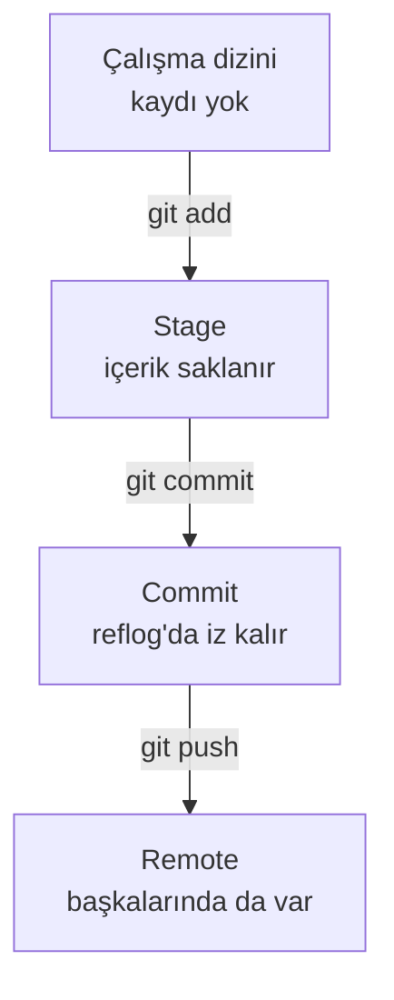

# Git'te güvenli geri alma: 10 komut

`git reset --hard` commit'lenmemiş değişikliği geri getirilemeyecek şekilde siler; çoğu durumda aynı işi daha güvenli
bir komut görür. Bu referans, durumu görmekten kaybolan commit'i bulmaya kadar on komutu, her birinin neyi geri
aldığını ve neyi geri alamadığını çalıştırılmış örneklerle veriyor.

| Alan | Değer |
|---|---|
| Tür | Reference |
| Alan | Software Engineering · Git |
| Ön bilgi | `git add`, `git commit` ve `git push` kullanmış olmak |
| Denendiği ortam | Git 2.54.0 · macOS (arm64) |
| Örnek dosyalar | [`guvenli-geri-alma/`](guvenli-geri-alma/) — `./demo.sh` bu sayfadaki bütün çıktıları geçici bir repoda yeniden üretir |
| Tarih | 2026-10-04 |

> **Kısa cevap:** Atmadan önce kenara koyun (`git stash`). Paylaşılmış commit'i silmeyin, geri alın (`git revert`).
> Bir commit kaybolduysa önce `git reflog`'a bakın. Git commit'lediğinizi kolay kaybetmez; commit'lemediğinizi
> koruyamaz.

---

## 1. Neden?

Git'te bir değişiklik dört yerden birinde durur. Geri alma komutlarının farkı hangisine dokunduklarıdır; bir
değişikliğin kurtarılıp kurtarılamayacağını da durduğu yer belirler.



`git reset --hard` çalıştırdığınızda her birine ne olduğunu ölçtük ([§ 8](#8-karşı-örnek-reflogun-kurtaramadığı)):

| Değişiklik nerede | `reset --hard` sonrası | Kurtarma |
|---|---|---|
| Çalışma dizininde, `git add` yapılmamış | Silinir | **Yok** |
| Stage'de, commit'lenmemiş | Silinir | İçerik `git fsck --lost-found` ile bulunur; dosya adı kaybolur |
| Commit'te | Branch'ten düşer | `git reflog` ile bulunur |
| Takip edilmeyen dosyada | Dokunulmaz | — |

Reflog sonsuza kadar tutmaz: kayıtlar varsayılan olarak 90 gün, branch'in güncel ucundan artık erişilemeyen
commit'lerin kayıtları 30 gün sonra `git gc` tarafından silinebilir (`gc.reflogExpire`, `gc.reflogExpireUnreachable`).

## 2. On komut

| # | Komut | Ne yapar | Geri alınır mı |
|---|---|---|---|
| 1 | `git status` | Neyin değiştiğini ve neyin stage'de olduğunu gösterir | Bir şey değiştirmez |
| 2 | `git diff --staged` | Commit'e girecek değişikliği gösterir | Bir şey değiştirmez |
| 3 | `git log --oneline --graph` | Geçmişi tek satırda, dallanmasıyla gösterir | Bir şey değiştirmez |
| 4 | `git restore --staged <dosya>` | Dosyayı stage'den çıkarır; değişiklik dosyada kalır | Evet: yeniden `git add` |
| 5 | `git restore <dosya>` | Dosyadaki commit'lenmemiş değişikliği atar | **Hayır** |
| 6 | `git stash` | Yarım işi kenara koyar, çalışma dizinini temizler | Evet: `git stash pop` |
| 7 | `git stash pop` | Kenara konanı geri getirir, stash'ten siler | Evet: yeniden `git stash` |
| 8 | `git commit --amend` | Son commit'in mesajını ya da içeriğini düzeltir | Evet: eski commit reflog'da |
| 9 | `git revert <commit>` | Bir commit'in tersini yeni bir commit olarak ekler | Evet: revert commit'i de revert edilir |
| 10 | `git reflog` | HEAD'in bulunduğu her commit'i listeler | Bir şey değiştirmez |

Hangi durumda hangisi:

| Durum | Komut |
|---|---|
| Yanlış dosyayı `git add` yaptım | `git restore --staged <dosya>` |
| Bu dosyadaki değişikliği istemiyorum | `git restore <dosya>` |
| Değişiklik şimdi lazım değil ama kaybetmek istemiyorum | `git stash` |
| Son commit'in mesajı yanlış, henüz push etmedim | `git commit --amend` |
| Push ettiğim commit hatalı | `git revert <commit>` |
| Commit'im kayboldu | `git reflog` |

## 3. Durumu görmek (1–3)

Yıkıcı bir komuttan önce ilk iş, neyin kaybedileceğine bakmaktır. Örnek repoda bir dosya değiştirildi, biri stage'e
alındı, bir de yeni dosya var:

```text
$ git status
On branch main
Changes to be committed:
  (use "git restore --staged <file>..." to unstage)
	modified:   notlar.md

Changes not staged for commit:
  (use "git add <file>..." to update what will be committed)
  (use "git restore <file>..." to discard changes in working directory)
	modified:   app.py

Untracked files:
  (use "git add <file>..." to include in what will be committed)
	deneme.txt
```

Git her bölümün altına o durumu geri alan komutu yazar; bu sayfadaki 4. ve 5. komut zaten bu çıktıda duruyor.

```text
$ git diff --staged
diff --git a/notlar.md b/notlar.md
index d812ee9..7a7a848 100644
--- a/notlar.md
+++ b/notlar.md
@@ -1 +1,2 @@
 # Notlar
+- stash denenecek
```

`git diff` tek başına yalnız stage'e alınmamış değişikliği gösterir; commit'e ne gireceğini `--staged` söyler.

```text
$ git log --oneline --graph
* 6a361f9 veda fonksiyonunu ekle
* 96cb8a2 ilk sürüm
```

## 4. Değişikliği geri almak (4–5)

```text
$ git restore --staged notlar.md
$ git status --short
 M app.py
 M notlar.md
?? deneme.txt
```

`notlar.md` stage'den çıktı, içindeki değişiklik duruyor. Bu komut hiçbir şey silmez.

```text
$ git restore app.py
$ git status --short
 M notlar.md
?? deneme.txt
```

`app.py` son commit'teki haline döndü; eklenen satır gitti. **`git restore <dosya>` da geri alınamaz**: `reset --hard`'ın
tek dosyalık halidir. Farkı kapsamıdır, yalnız adını yazdığınız dosyaya dokunur. Değişikliğe bir daha ihtiyacınız
olabilecekse onu atmayın, kenara koyun.

## 5. Kenara koymak (6–7)

```text
$ git stash
Saved working directory and index state WIP on main: 6a361f9 veda fonksiyonunu ekle
$ git status --short
?? deneme.txt
$ git stash list
stash@{0}: WIP on main: 6a361f9 veda fonksiyonunu ekle
```

`git stash pop` değişikliği geri getirir ve stash'ten siler; çıktısının son satırı silinen kaydın hash'idir:

```text
Dropped refs/stash@{0} (6802bc11e181ecacb9f0431fd534c0b9b3f13136)
```

Üç ayrıntı:

- **Takip edilmeyen dosya stash'e girmez.** Yukarıda `deneme.txt` yerinde kaldı. Onu da kenara koymak için
  `git stash -u`.
- **Silinen stash bulunabilir.** `git stash drop` ya da `pop` çıktısındaki hash ile `git stash apply <hash>` kaydı geri
  getirir. Hash'i kaçırdıysanız `git fsck --lost-found` onu `dangling commit` olarak listeler
  ([§ 8](#8-karşı-örnek-reflogun-kurtaramadığı)).
- **Çakışan `pop` stash'i silmez.** Kenara koyduğunuz değişiklik, sonradan commit'lenen bir değişiklikle aynı satıra
  dokunuyorsa:

  ```text
  $ git stash pop
  Auto-merging notlar.md
  CONFLICT (content): Merge conflict in notlar.md
  …
  The stash entry is kept in case you need it again.
  ```

  Çakışmayı çözüp `git add` yaptıktan sonra kaydı `git stash drop` ile siz silersiniz.

## 6. Commit'i düzeltmek (8–9)

### Push etmediyseniz: `amend`

```text
$ git commit --amend -m "notları güncelle"
önce: ac91240  sonra: de52a24
```

`amend` commit'i düzenlemez, yerine yenisini yazar: hash değişir. Eski commit silinmez, reflog'da durur. Commit'i push
ettiyseniz remote'taki geçmiş ile sizinki artık farklıdır; push reddedilir, zorlarsanız o commit'i çekmiş herkesin
geçmişi bozulur.

### Push ettiyseniz: `revert`

```text
$ git revert --no-edit HEAD
[main 78b53d8] Revert "notları güncelle"
 Date: Sun Oct 4 12:00:00 2026 +0300
 1 file changed, 1 deletion(-)
$ git log --oneline
78b53d8 Revert "notları güncelle"
de52a24 notları güncelle
6a361f9 veda fonksiyonunu ekle
96cb8a2 ilk sürüm
```

Hatalı commit geçmişte kalır, üstüne onun tersini yapan yeni bir commit gelir. Geçmiş değişmediği için normal bir
`git push` yeter. `git revert` temiz bir çalışma dizini ister; yarım işiniz varsa önce `git stash`.

## 7. Kaybolanı bulmak (10)

Son iki commit'i `reset --hard` ile sildik:

```text
$ git reset --hard HEAD~2
HEAD is now at 6a361f9 veda fonksiyonunu ekle
$ git log --oneline
6a361f9 veda fonksiyonunu ekle
96cb8a2 ilk sürüm
```

`git log` onları artık göstermiyor, ama reflog HEAD'in bulunduğu her yeri hatırlıyor:

```text
$ git reflog -4
6a361f9 HEAD@{0}: reset: moving to HEAD~2
78b53d8 HEAD@{1}: revert: Revert "notları güncelle"
de52a24 HEAD@{2}: commit (amend): notları güncelle
ac91240 HEAD@{3}: commit: notlari guncelle
```

`HEAD@{1}`, `reset`'ten bir önceki konum. Oraya dönmek:

```text
$ git reset --hard HEAD@{1}
HEAD is now at 78b53d8 Revert "notları güncelle"
```

İki commit de geri geldi. Bulunduğunuz yeri değiştirmeden kurtarmak isterseniz commit'e yeni bir branch verin:
`git branch kurtarma 78b53d8`. Reflog yereldir; push edilmez, başka bir klonda bulunmaz.

## 8. Karşı örnek: reflog'un kurtaramadığı

Reflog commit'leri izler. Commit'lenmemiş değişikliğin kaydı yoktur. Aynı anda üç tür değişiklik hazırladık:
`app.py`'de stage'e alınmamış bir satır, stage'e alınmış yeni bir `taslak.md` ve takip edilmeyen `deneme.txt`.

```text
$ git status --short
 M app.py
A  taslak.md
?? deneme.txt
$ git reset --hard
HEAD is now at 78b53d8 Revert "notları güncelle"
$ git status --short
?? deneme.txt
```

| Dosya | Durumu | Sonuç |
|---|---|---|
| `app.py` | Değiştirilmiş, `git add` yok | Satır gitti, kurtarılamaz |
| `taslak.md` | `git add` yapılmış, commit yok | Dosya silindi; içeriği bulunabilir |
| `deneme.txt` | Takip edilmiyor | Yerinde |

`git add` dosyanın içeriğini Git'in nesne deposuna yazar. Commit olmadığı için ona işaret eden bir şey yoktur, ama
içerik bir süre orada durur:

```text
$ git fsck --lost-found
dangling blob a00ee085402a624150b3cfa9a0662420c80fca74
dangling commit 6802bc11e181ecacb9f0431fd534c0b9b3f13136
dangling commit ac91240aa424dcc6d528668c1fd120c8da59abca
$ git cat-file -p a00ee085402a624150b3cfa9a0662420c80fca74
yarım taslak
```

`dangling blob`, `taslak.md`'nin içeriği: dosya adı ve yolu kayıp, metin duruyor. İki `dangling commit`'ten ilki
[§ 5](#5-kenara-koymak-67)'te silinen stash, ikincisi `amend`'in yerine yenisini yazdığı eski commit.

Buradan çıkan pratik kural: uzun bir işin ortasında `git add` yapmak bile bir sigortadır, ama asıl sigorta
commit'tir. Ara commit'ler push etmeden önce birleştirilebilir; kaybolan satır geri getirilemez.

## 9. `reset --hard` ne zaman doğru komut?

Yasak bir komut değil; ne sildiğini bilerek kullanılır.

- **Değişikliği gerçekten atmak istediğinizde.** `git status` ile baktınız ve kaybedilecek bir şey yok.
- **Yerel branch'i remote ile eşitlerken.** `git fetch` ardından `git reset --hard origin/main`. Yerel commit'ler
  branch'ten düşer ama reflog'da kalır; commit'lenmemiş değişiklik gider.
- **Reflog'dan geri dönerken**, [§ 7](#7-kaybolanı-bulmak-10)'deki gibi.

Kullanılmayacağı yerler:

| Amaç | `reset --hard` yerine |
|---|---|
| Değişikliğe sonra dönmek | `git stash` |
| Tek bir dosyayı eski haline getirmek | `git restore <dosya>` |
| Push edilmiş bir commit'i geri almak | `git revert <commit>` |
| Takip edilmeyen dosyaları silmek | `git clean`; `reset --hard` onlara dokunmaz. Önce `git clean -n` neyin silineceğini gösterir |

## 10. Eski Git sürümleri

`git restore`, Git 2.23 (Ağustos 2019) ile geldi. Daha eski bir Git'te karşılıkları:

| Yeni | Eski |
|---|---|
| `git restore <dosya>` | `git checkout -- <dosya>` |
| `git restore --staged <dosya>` | `git reset HEAD <dosya>` |

Eski komutlar yeni sürümlerde de çalışır. `git --version` hangi sürümde olduğunuzu söyler.

## 11. Kontrol listesi

Yıkıcı bir komuttan (`reset --hard`, `restore <dosya>`, `clean`, `stash drop`) önce:

- [ ] `git status` çalıştırdım; neyin değişeceğini biliyorum
- [ ] Kaybetmek istemediğim değişiklik bir commit'te ya da stash'te
- [ ] Takip edilmeyen ama lazım olan dosya yok (`stash` onları almaz, `clean` siler)
- [ ] Değiştireceğim commit push edilmedi; edildiyse `revert` kullanıyorum
- [ ] Kaybolan bir commit'i ararken yeni bir şey silmeden önce `reflog`'a baktım

## 12. Alıştırma

1. [`guvenli-geri-alma/`](guvenli-geri-alma/) klasöründe `./demo.sh` çalıştırın. On beş kontrolün hepsi `[ok]` yazmalı;
   commit hash'leri bu sayfadakilerle aynı çıkar, çünkü script yazarı ve tarihi sabitler.
2. Script repoyu çakışmanın ortasında bırakır ve yolunu son satırda yazar. O klasörde `git status` ile duruma bakın,
   `notlar.md`'deki çakışmayı çözün, `git add notlar.md` ve `git stash drop` ile bitirin.
3. Aynı repoda `git reset --hard HEAD~1` çalıştırın, sonra commit'i bu kez `reset` ile değil
   `git branch kurtarma <hash>` ile geri getirin.
4. Kendi reponuzda `git reflog` çalıştırın. Son hafta HEAD kaç kez yer değiştirmiş, kaç tanesini hatırlıyorsunuz?

## Kaynaklar

- Git — [git-restore](https://git-scm.com/docs/git-restore) · [git-stash](https://git-scm.com/docs/git-stash) ·
  [git-revert](https://git-scm.com/docs/git-revert) · [git-reset](https://git-scm.com/docs/git-reset) ·
  [git-reflog](https://git-scm.com/docs/git-reflog) · [git-fsck](https://git-scm.com/docs/git-fsck).
- Git — [git-gc](https://git-scm.com/docs/git-gc): `gc.reflogExpire` (90 gün) ve `gc.reflogExpireUnreachable` (30 gün)
  varsayılanları.
- Pro Git — [Undoing Things](https://git-scm.com/book/en/v2/Git-Basics-Undoing-Things) ·
  [Reset Demystified](https://git-scm.com/book/en/v2/Git-Tools-Reset-Demystified).
- Örnekler: [`guvenli-geri-alma/demo.sh`](guvenli-geri-alma/demo.sh), 2026-10-04.
